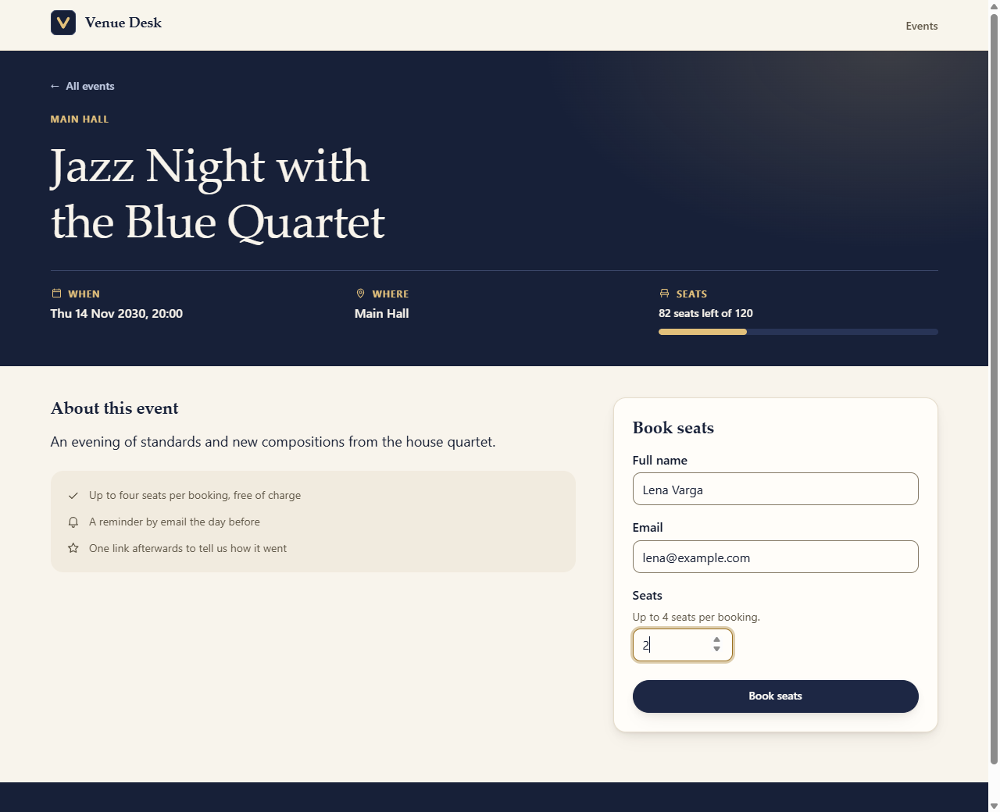
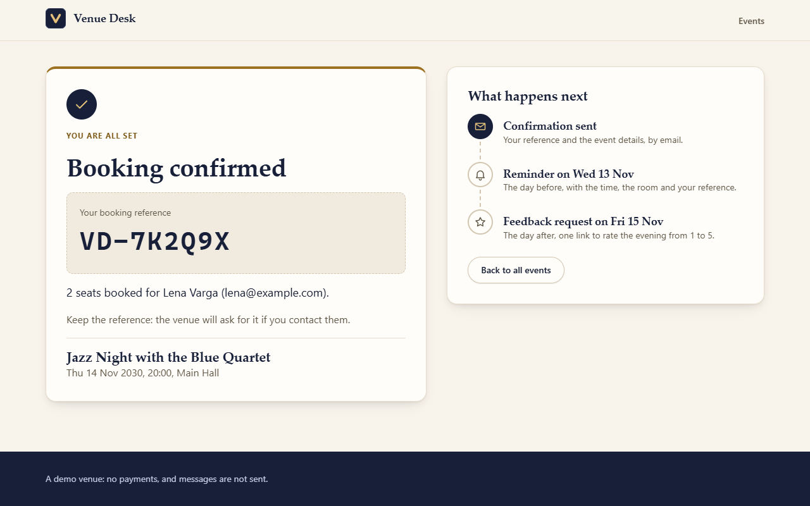
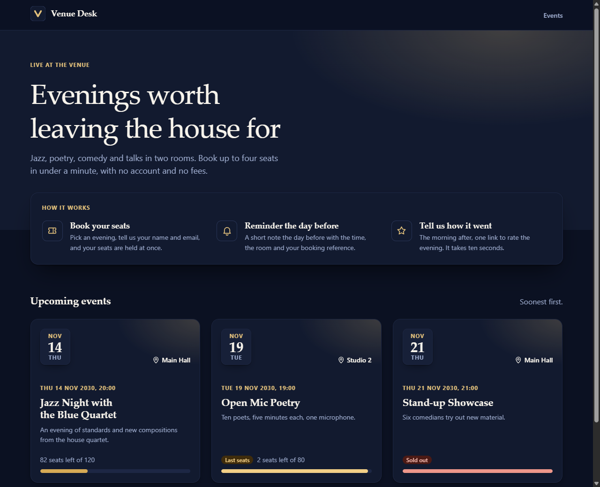

# Venue Desk Svelte

The guest side of Venue Desk in Svelte 5 and SvelteKit: guests see what is coming up, book seats
in under a minute, get a confirmation with what happens next, and rate the evening through a link.

It is a port of the guest pages of
[venue-desk-web](https://github.com/SilverSlytherin1/venue-desk-web), the Angular frontend, against
the same [venue-desk-api](https://github.com/SilverSlytherin1/venue-desk-api) contract. The
behaviour is kept and the code is written the Svelte way. It runs against the real API, and its
whole test suite runs without it.

<p>
  
  
</p>
<p>
  
</p>

## Run it

Requires Node 22.17 or newer (SvelteKit 3 asks for it).

```bash
git clone https://github.com/SilverSlytherin1/venue-desk-svelte.git
cd venue-desk-svelte
npm ci
npm run dev        # http://localhost:5173
```

The dev server proxies `/api` to `http://localhost:3000` (`vite.config.ts`). Start the API with its
demo data from [its own repository](https://github.com/SilverSlytherin1/venue-desk-api) with
`docker compose up --build`. A past evening can be rated through the fixed demo link
`http://localhost:5173/feedback/5f0c2a9e-8d1b-4c3e-9a7f-2b6d4e8c1a35`.

Dates and times are shown on the venue's clock, not the browser's. The zone is one setting,
`VENUE_TIME_ZONE` in `src/lib/venue-date.ts` (default `Europe/Rome`), and it must match the API's.
Every date goes through `Intl` with an explicit `timeZone`.

### Without the API

```bash
npm run test:ci    # unit tests: Vitest, jsdom, no browser needed
npm run e2e        # starts the dev server, then runs Cypress headless with every API call stubbed
```

Other scripts: `npm run check`, `npm run lint`, `npm run format:check`, `npm run build`.

## Where to look first

```
src/lib
  api/        typed models of the contract, the fetch wrapper, the error model
  forms/      field wrapper, validation wording
  events/     booking panel, form and flow, timeline, event card, availability
  feedback/   the guest's rating panel
  ui/         presentational primitives: alert, error state, stars, icons
  styles/     design tokens and base elements
src/routes    one folder per page, each with its load function
```

These files show most of how the app is put together:

1. `src/lib/api/client.ts` and `api-problem.ts`: every HTTP failure becomes one typed `ApiProblem`.
2. `src/lib/events/booking-flow.svelte.ts`: the booking as a class with runes, with the idempotency
   key and each failure the contract defines.
3. `src/routes/events/[id]/+page.svelte` and `booked/+page.svelte`: how the confirmation travels in
   the history entry.
4. `src/lib/forms/FormField.svelte` and `src/lib/events/BookingForm.svelte`: snippets that tie a
   control to its label, hint and error.
5. `src/lib/events/BookingPanel.spec.ts`: what the tests look like.

## What changed from the Angular version

| Angular version                                   | Here                                                     |
| ------------------------------------------------- | -------------------------------------------------------- |
| Signals, `computed`, `linkedSignal`               | `$state`, `$derived`, and `{#key}` to start a panel over |
| `loadable()` with a state signal per view         | `load` functions that return an `ApiResult`              |
| HTTP interceptor around `HttpClient`              | `request()`, a wrapper around `fetch` that never throws  |
| `takeUntilDestroyed` on a write                   | `AbortController`, aborted in `onDestroy`                |
| Reactive forms and a `ValidatedForm` directive    | `$state` fields, errors as one `$derived` object         |
| Content projection and a `FieldControl` directive | A snippet that receives the attributes for the control   |
| Router navigation state                           | `goto` with `state` and `persistState`                   |
| `RouteFocus` directive on the router events       | `afterNavigate` in the root layout                       |
| SCSS tokens                                       | Plain CSS custom properties, the same values             |

## Decisions and trade-offs

**One error model, no exceptions.** The API answers failures with `application/problem+json` and a
stable `code`. `request()` returns `{ ok: true, value }` or `{ ok: false, problem }`, and features
switch on `problem.code`, never on a status or a message. One code is added on the client,
`NETWORK_ERROR`, for the case where there is no response to carry one. Successful bodies are trusted
to match the contract types, which come from the Angular repository's models.

**`load` decides when a page appears.** A navigation waits for its data, so a page has no loading
state of its own: the layout shows a thin progress bar and announces the wait. The cost is that
the first load of the app is a blank page until the API answers, where the Angular version shows
skeletons. Returning unresolved promises from `load` would bring those back, at the price of a
form that is torn down when the event refreshes. A failed read stays in the page's data so it can
offer "Try again"; an address that cannot exist (`NOT_FOUND`, or an id that is not a UUID) throws
to the not-found page.

**Safe retries, and only where they are safe.** A booking carries an `Idempotency-Key`. The key
belongs to the details that were submitted: sending the same details again replays the key, and
editing them makes a new one. The page offers "Try again" only when the outcome is unknown (no
response, or a server error). A sell-out, a closed event, a rate limit and a reused key each get
their own message and next step. After a sell-out the event reloads, the page says how many seats
are left, and the form keeps what was typed.

**A confirmation is not a URL.** The confirmation page renders the booking the API returned, handed
over with `goto` in `page.state`. `persistState` keeps it in the history entry, so a reload keeps
the page, while a typed or shared address has no booking and goes to the event page.

**Components stay testable without the router.** `$app/navigation` is called from route files only.
`BookingPanel` and `FeedbackPanel` receive callbacks, so unit tests stub nothing but `fetch`. The
wiring in the route files is covered by Cypress instead.

**`$effect` is not used.** Errors are derived, so seats that run out while the form is open
revalidate by themselves, and errors from the API are handed to the form through a function it
exports.

**Hand-written primitives and a designed theme.** The look is "evening at the venue": ink navy, a
brass accent and warm paper, all from system font stacks. The dark theme is its own set of semantic
tokens. Components use scoped styles over semantic tokens, and `tokens.spec.ts` fails the test run
if a text and background pair drops below AA contrast in either theme.

**Tests exercise behaviour through the DOM.** Unit tests find elements by role and accessible name
and replace only `fetch`, so an inaccessible control fails a test. Cypress covers the main journeys
in a real browser with fixtures shaped like the contract, and fails any call that was not stubbed.

**Accessibility is part of the structure.** Focus moves to the page heading on navigation and to
the first invalid field on a failed submit. Errors are tied to their field with `aria-describedby`,
async results are announced through live regions, and the star rating is a native radio group, so
the arrow keys and screen readers work without extra code.

## Deliberately out of scope

- The staff area, login and work orders: those live in the Angular version.
- Pagination: the home page asks for the next 12 events and says how many there are in total.
- Server-side rendering: this is a single-page app, built with `adapter-static` and a fallback page.
- Internationalisation: copy is inline English and dates use one format.
- A manual theme switch: the theme follows the operating system.
- Offline support and optimistic updates.

---

Emanuel Pinto, riverdevstudio.it. MIT licensed.
